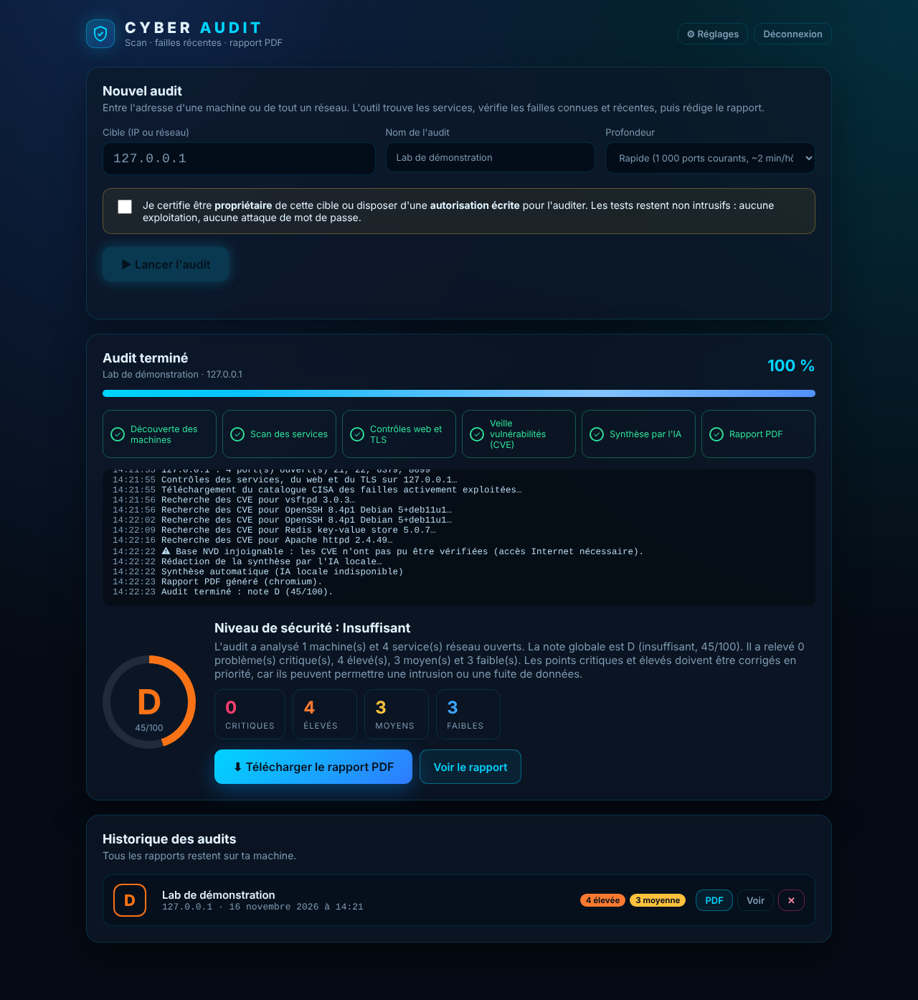
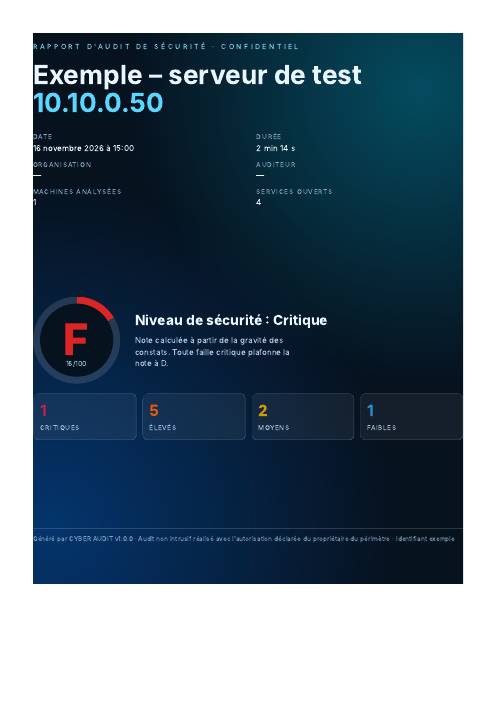
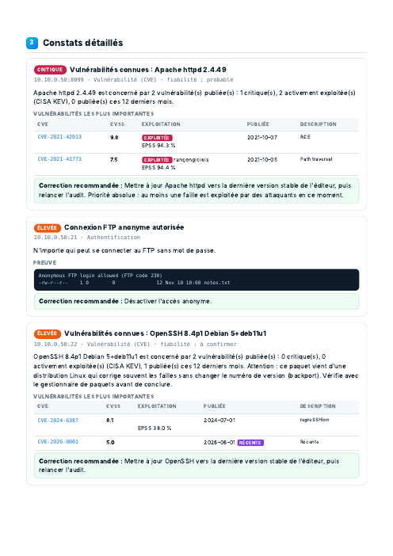
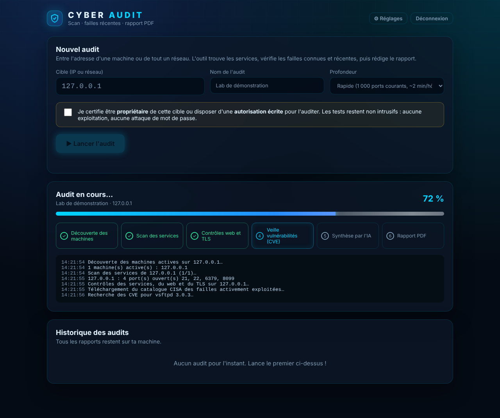

<div align="center">

# 🛡️ CYBER AUDIT

**L'audit de sécurité automatique de ton réseau, en un clic, avec un rapport PDF professionnel.**

Tu donnes une IP ou un réseau. L'outil trouve les machines et les services, cherche les failles connues (y compris les CVE récentes et celles exploitées activement), puis te livre un rapport PDF clair avec une note de A à F et un plan d'action.




</div>

---

## ✨ Ce que ça fait

| Étape | Détail |
|---|---|
| 🔎 **Découverte** | Trouve les machines actives sur une IP, une plage ou un réseau (jusqu'à /20). |
| 🧭 **Scan des services** | Nmap : ports ouverts, versions, OS (profil *rapide* top 1000 ports ou *complet* 65 535 ports). |
| 🌐 **Contrôles web et TLS** | HTTP sans HTTPS, en-têtes de sécurité manquants, fichiers sensibles exposés (`/.git`, `/.env`, `phpinfo`…), certificats expirés ou auto-signés, TLS 1.0/1.1. |
| 🧨 **Veille vulnérabilités** | Chaque version détectée est croisée avec la base **NVD** (CVE), le catalogue **CISA KEV** (failles exploitées en ce moment) et le score **EPSS** (probabilité d'exploitation). Les CVE des 12 derniers mois sont marquées *RÉCENTE*. |
| 🤖 **Synthèse par IA** | Un modèle local via [Ollama](https://ollama.com) rédige le résumé pour la direction et le plan d'action. Sans Ollama, une synthèse automatique est faite quand même. |
| 📄 **Rapport PDF** | Couverture avec note A à F, synthèse, inventaire, chaque faille avec preuve et correction recommandée, méthodologie. |

👉 Exemple de rapport : [`docs/exemple-rapport.pdf`](docs/exemple-rapport.pdf)

<p align="center">
  
  
</p>

---

## 🚀 Installation (une commande)

Il faut juste une machine Linux avec **Docker** (une VM Debian/Ubuntu suffit).

```bash
git clone https://github.com/<ton-compte>/cyber-audit.git
cd cyber-audit
./install.sh
```

Le script crée un mot de passe aléatoire dans `.env`, construit l'image (Nmap et Chromium inclus) et démarre le service. À la fin, il affiche l'adresse :

```
CYBER AUDIT est prêt : http://192.168.1.20:8090
```

Ouvre cette adresse, connecte-toi avec le mot de passe affiché, c'est tout.

<details>
<summary><b>Installation manuelle avec Docker Compose</b></summary>

```bash
cp .env.example .env      # puis choisis un mot de passe solide dans .env
docker compose up -d --build
```
</details>

<details>
<summary><b>Sans Docker (Python)</b></summary>

```bash
sudo apt install nmap chromium        # Chromium sert à produire le PDF
python3 -m venv .venv && . .venv/bin/activate
pip install -r requirements.txt
export AUDIT_PASSWORD='un-mot-de-passe-solide'
export CHROME_PATH=/usr/bin/chromium
sudo -E .venv/bin/python run.py --host 0.0.0.0   # root = détection d'OS et scan plus rapide
```
</details>

**Commandes utiles**

```bash
docker compose logs -f        # voir les journaux
git pull && docker compose up -d --build   # mettre à jour
docker compose down           # arrêter
```

---

## 🖱️ Utilisation

1. **Nouvel audit** : saisis la cible (`10.10.0.105`, `10.10.0.0/24` ou `10.10.0.1-50`), un nom, le profil.
2. Coche **« J'ai l'autorisation d'auditer cette cible »**.
3. Clique **Lancer** et suis les 6 étapes en direct.
4. Télécharge le **PDF** ou ouvre le rapport dans le navigateur. Les audits passés restent dans l'historique.

<p align="center"></p>

**Réglages** (icône ⚙️) : plages autorisées, URL d'Ollama et modèle (`qwen3:8b` par défaut), clé API NVD facultative (scans CVE beaucoup plus rapides, [gratuite ici](https://nvd.nist.gov/developers/request-an-api-key)), nom de l'auditeur et de l'organisation pour le rapport.

---

## 🔐 Sécurité et éthique

> ⚠️ **N'audite que des systèmes qui t'appartiennent ou pour lesquels tu as une autorisation écrite.** Scanner un système sans autorisation est illégal (en France : art. 323-1 et suivants du Code pénal).

- **Périmètre limité par défaut** : seuls les réseaux privés (10.x, 172.16-31.x, 192.168.x) et 127.x sont acceptés. Une IP publique doit être ajoutée volontairement dans les réglages.
- **Tests non intrusifs** : uniquement des scripts Nmap classés `safe`, pas d'exploitation, pas de force brute, pas de déni de service.
- **Accès protégé** : mot de passe obligatoire, cookie de session signé, limite de 5 essais ratés par 5 minutes, protection CSRF.
- **Tout reste chez toi** : l'IA tourne en local (Ollama). Seuls les identifiants de logiciels (CPE) sont envoyés à la NVD pour chercher les CVE, jamais tes IP.

**Limites à connaître** : un scan détecte des *versions*, pas des failles prouvées. Les distributions comme Debian corrigent souvent sans changer le numéro de version : ces CVE sont marquées « à confirmer ». Le rapport ne remplace pas un test d'intrusion manuel.

---

## 🧱 Architecture

```
Navigateur ──► FastAPI (app/main.py)
                 │
                 └─► jobs.py : audit en tâche de fond, 6 étapes
                       1. scanner.py   Nmap découverte (-sn)
                       2. scanner.py   Nmap services (-sV, scripts safe) → XML
                       3. checks.py    services à risque, HTTP, TLS
                       4. vulns.py     NVD (CPE → CVE) + CISA KEV + EPSS, cache 24 h
                       5. ai.py        synthèse Ollama (ou synthèse automatique)
                          scoring.py   note A–F
                       6. report.py    HTML (Jinja2) → PDF (Chromium headless)
```

Les données sont dans `./data` : réglages et un dossier par audit (`audit.json`, `rapport.html`, `rapport.pdf`).

---

## 🧪 Tests

```bash
pip install -r requirements.txt pytest
pytest -q
```

Les tests utilisent des résultats Nmap enregistrés (`tests/fixtures`) et des réponses NVD simulées : ils tournent sans réseau et sans Nmap. `python tests/make_demo.py` régénère l'exemple de rapport.

---

## 🗺️ Évolutions prévues

- [ ] Audits planifiés (chaque semaine) avec comparaison avant/après
- [ ] Notification à la fin d'un audit (ntfy, e-mail)
- [ ] Export JSON/CSV des failles
- [ ] Contrôles Active Directory et Wi-Fi
- [ ] Rapport en anglais

---

## 📜 Licence

[MIT](LICENSE). Projet personnel, fourni sans garantie. À utiliser de façon responsable.
